# Focus (포커스)

> 모바일 중심 국내 주식 리서치 웹앱 — 시세 조회, 기간별 차트, 종목 검색, 관심 종목, 종목 커뮤니티, AI 데모 채팅

**🔗 데모: https://majestic-medovik-21b368.netlify.app** (샘플 시세 모드)

Focus는 꼭 필요한 정보만 깔끔하게 보여 주는 국내 주식 리서치 앱입니다.
흰 배경과 넉넉한 여백, 선명한 파란색 포인트, 큼직한 가격 숫자로 모바일에서 빠르게 훑어볼 수 있게 만들었습니다.

- **키 없이 바로 실행** — 기본값은 샘플 시세(`DATA_PROVIDER=mock`)라 공개 데모의 모든 화면을 볼 수 있습니다.
- **실제 시세 연동** — `DATA_PROVIDER=kis`로 바꾸면 한국투자증권 KIS Open API의 현재가와 국내주식 기간별시세를 서버에서 조회합니다.
- **같은 데이터 형식** — 두 모드 모두 Route Handler가 같은 JSON 형식으로 응답하고, 화면에는 출처(`샘플 시세` / `한국투자증권 시세`)와 기준일 또는 조회 시각을 표시합니다.

> ⚠️ 이 프로젝트는 포트폴리오용 데모입니다. 샘플 시세는 실제 시세가 아니며, AI 탭의 답변은 미리 작성된 예시입니다. 투자 권유가 아닙니다.

## 주요 화면

| 홈 | 종목 상세 · 차트 | 관심 종목 |
| :---: | :---: | :---: |
| 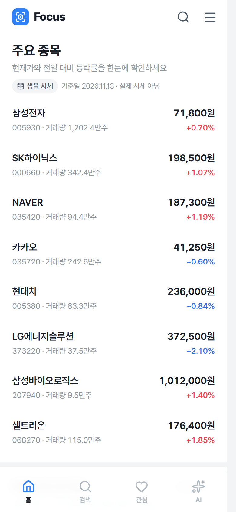 | 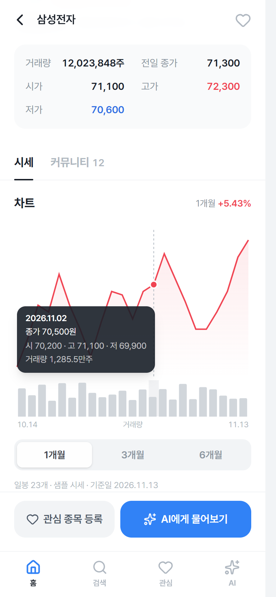 | 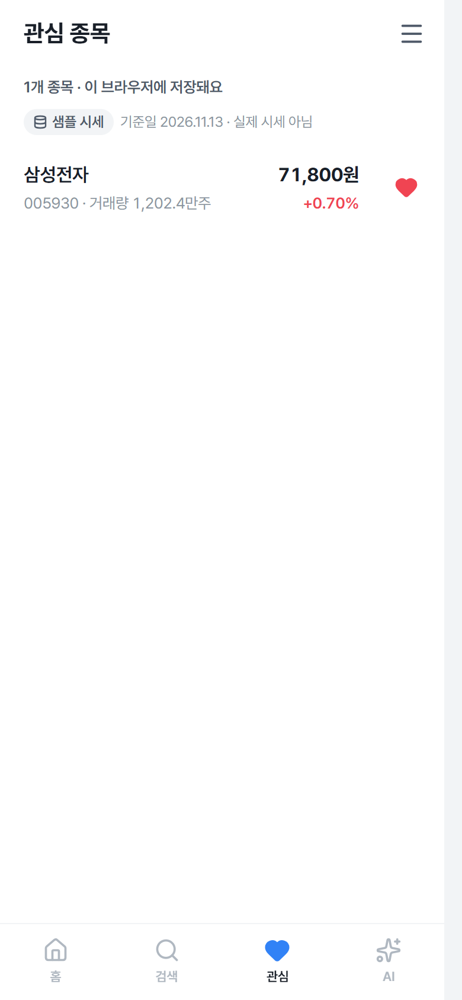 |

| 검색 | AI 데모 채팅 | 데스크톱 |
| :---: | :---: | :---: |
| 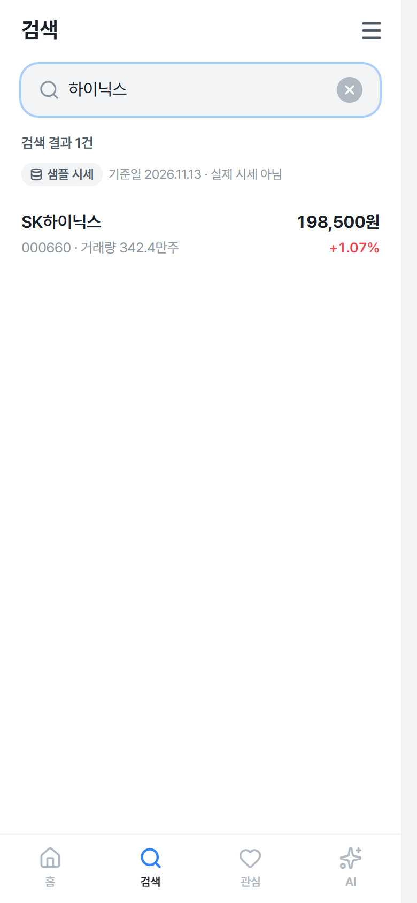 | 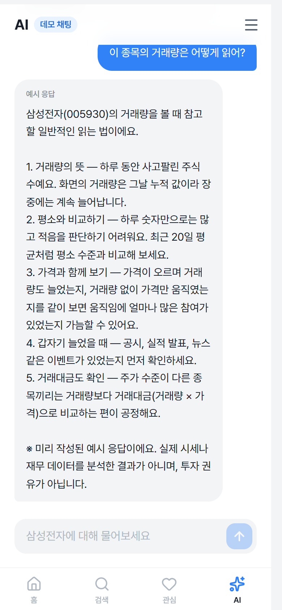 | 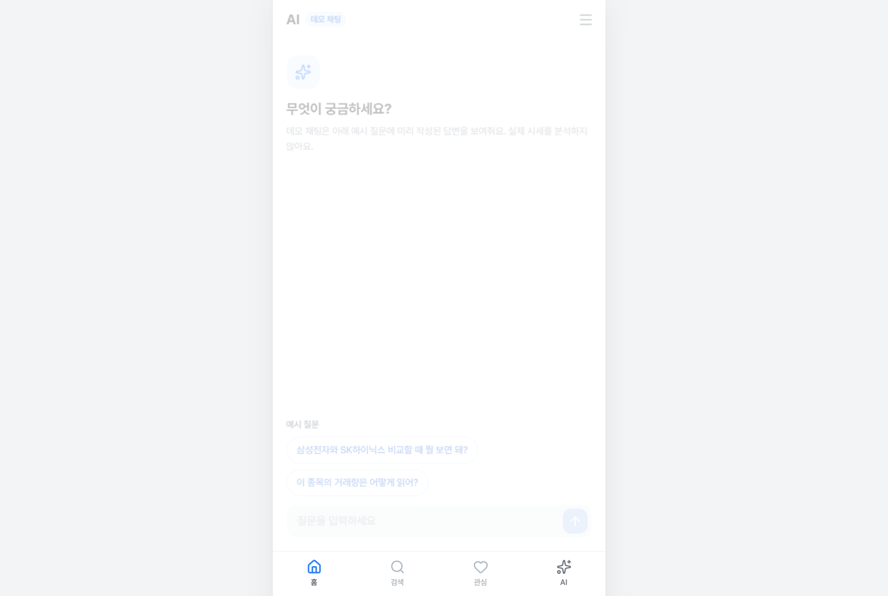 |

| 전체 메뉴 | 내 정보 | 종목 커뮤니티 |
| :---: | :---: | :---: |
| 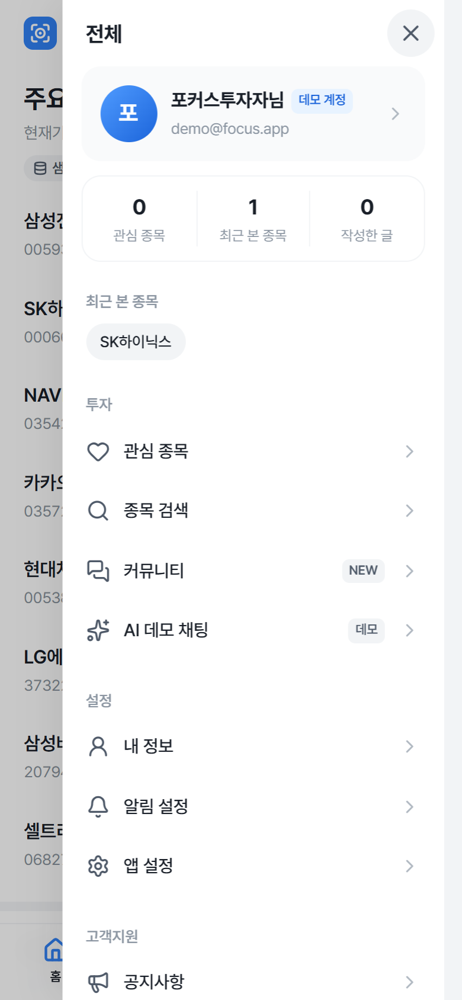 | 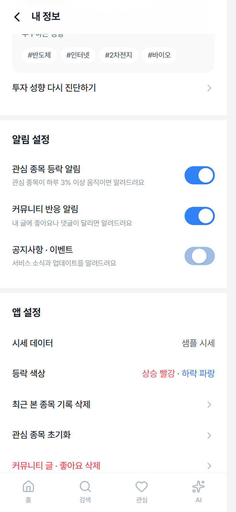 | 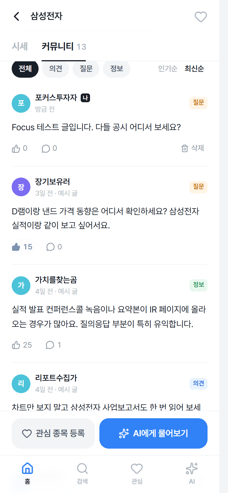 |

| 커뮤니티 피드 · 댓글 | 갤럭시 폴드 접힘 (280px) | 가로 모드 (844×390) |
| :---: | :---: | :---: |
| 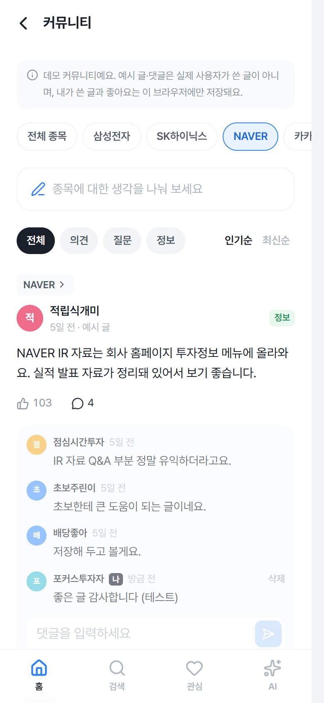 | 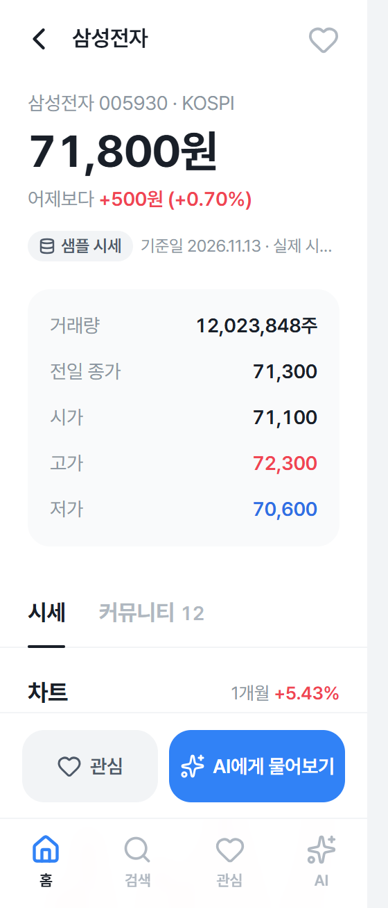 | 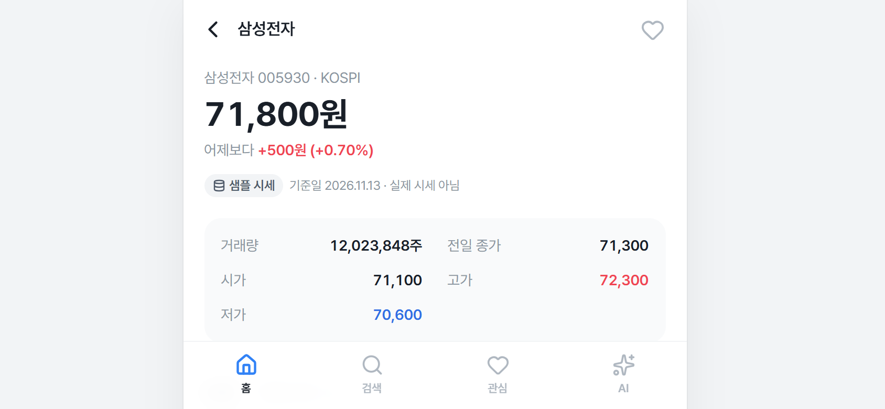 |

<sub>스크린샷은 샘플 시세 모드에서 촬영했습니다. (`npm run build && SCREENSHOTS=1 npm run test:e2e`로 다시 생성)</sub>

## 기능

| 탭 / 화면 | 내용 |
| --- | --- |
| **홈** | 주요 종목의 종목명, 현재가, 전일 대비 등락률, 거래량. 누르면 상세로 이동 |
| **검색** | 지원 종목을 종목명(부분 일치·영문 별칭) 또는 종목코드로 검색. 결과 없음 상태 표시 |
| **종목 상세** | 현재가, 전일 대비(원·%), 거래량, 시가·고가·저가, 일봉 차트(`1개월 / 3개월 / 6개월`), 관심 등록, `AI에게 물어보기`. `시세 / 커뮤니티` 탭 |
| **커뮤니티** | 홈 `커뮤니티 인기글` → 전체 피드(`/community`, 종목 필터·종목 선택 글쓰기)와 종목 상세 `커뮤니티` 탭. 종목당 예시 글 12개와 예시 댓글(업종별 글 포함). 말머리 필터, 인기순·최신순, 글쓰기, 좋아요, 댓글, 내 글·댓글 삭제. 예시 글은 `예시 글`로 표시하고, 내가 쓴 내용은 이 브라우저에만 저장 |
| **전체 메뉴 (햄버거)** | 더미 프로필, 내 활동(관심·최근 본 종목·작성한 글 수), 최근 본 종목, 메뉴(관심 종목·검색·AI·내 정보·알림 설정·고객지원) |
| **내 정보** | 더미 프로필, 내 활동과 최근 작성 글, 투자 성향(더미), 알림 설정 토글(저장됨), 시세 데이터 모드, 기록 초기화, 앱 정보 |
| **관심** | localStorage에 저장한 관심 종목 조회·해제. 새로고침해도 유지되고, 다른 브라우저 탭과 동기화 |
| **AI** | `데모 채팅`. 예시 질문, 메시지 목록, 입력창. 상세에서 들어오면 선택한 종목명과 코드 표시 |

- 상승은 빨강과 `+`, 하락은 파랑과 `−`(U+2212)로 표시합니다.
- 하단 탭(`홈 / 검색 / 관심 / AI`)은 모바일에서 화면 하단에 고정됩니다. 데스크톱에서는 가운데 정렬된 앱 컬럼에서 같은 동선으로 씁니다.
- **화면 전환 모션** (React `<ViewTransition>` + `<Link transitionTypes>`, 별도 라이브러리 없음):
  - 목록 → 상세처럼 안으로 들어갈 때는 오른쪽에서 밀려 들어옵니다.
  - 하단 탭 전환과 뒤로가기는 살짝 떠오르는 페이드로 바뀌고, 하단 탭 바는 움직이지 않습니다.
  - 상세 화면의 `시세 / 커뮤니티` 탭은 내용만 크로스페이드합니다. 드로어는 열림·닫힘 모두 슬라이드합니다.
  - OS의 '동작 줄이기' 설정을 존중합니다. View Transition을 지원하지 않는 브라우저에서는 애니메이션 없이 그대로 동작합니다.
- 모든 탭이 같은 헤더(높이·제목 위치)를 쓰고 스크롤바 자리를 고정(`scrollbar-gutter: stable`)해, 탭을 오갈 때 레이아웃이 흔들리지 않습니다.
- **반응형**: 갤럭시 폴드 접힘(280px)부터 iPhone SE, 일반·대형 폰, 가로 모드, 태블릿까지 가로 넘침 없이 동작합니다.
  - 노치 safe-area를 반영하고, iOS 입력창 자동 확대를 막기 위해 입력 글자 크기를 16px 이상으로 맞췄습니다.
  - 아주 좁은 화면에서는 버튼 문구를 줄이고, 세로가 짧은 화면에서는 하단 고정 버튼 줄을 고정하지 않습니다.
  - 7가지 화면 크기에서 자동 측정 테스트로 확인합니다.
- 로딩(스켈레톤), 조회 실패(원인 메시지 + `다시 시도`), 빈 데이터 상태를 모든 시세 영역에서 처리합니다.

## 기술 스택

- **Next.js 16 (App Router)**, React 19, TypeScript
- **Tailwind CSS v4**, Lucide 아이콘, Recharts
- 시세 API: Next.js Route Handler → 한국투자증권 KIS Open API (서버 전용)
- 테스트: Node test runner + tsx (단위), Playwright (E2E)

## 시작하기

Node.js 20 이상이 필요합니다.

```bash
npm install
cp .env.example .env.local   # 기본값은 샘플 모드(DATA_PROVIDER=mock)
npm run dev                  # http://localhost:3000
```

프로덕션 빌드로 실행하려면 다음 명령을 씁니다.

```bash
npm run build
npm run start
```

### 스크립트

| 명령 | 설명 |
| --- | --- |
| `npm run dev` | 개발 서버 |
| `npm run build` / `npm run start` | 프로덕션 빌드 / 실행 |
| `npm run lint` | ESLint |
| `npm run typecheck` | 라우트 타입 생성 후 `tsc --noEmit` |
| `npm test` | 단위 테스트 (검색, 포맷, 일봉 정규화, KIS 분할 조회·토큰 재사용·오류 처리, 데모 응답) |
| `npm run test:e2e` | E2E 테스트 (주요 흐름, 메뉴·내 정보, 커뮤니티, 탭 레이아웃 고정, 7가지 화면 크기 반응형) (`npm run build` 이후 실행. 기본으로 로컬 Edge를 쓰며, `PW_CHANNEL=chrome`으로 바꿀 수 있음) |

## 배포 (Netlify)

1. Netlify에서 **Add new project → Import an existing project → GitHub**를 누르고 `focus-invest` 저장소를 선택합니다.
2. 빌드 설정은 `netlify.toml`에서 자동으로 읽습니다 (`npm run build`, Node 22).
3. 환경변수 없이 배포하면 샘플 시세 모드로 동작합니다.
4. 실제 시세를 쓰려면 **Site configuration → Environment variables**에 아래 값을 추가하고 다시 배포합니다.
   - `DATA_PROVIDER=kis`, `KIS_APP_KEY`, `KIS_APP_SECRET`
   - 서버 함수에서 읽어야 하므로 Scope에 Functions를 포함해야 합니다.

> 서버리스 환경에서는 토큰 파일 캐시를 쓸 수 없어 메모리 캐시만 사용합니다. 함수 인스턴스가 새로 뜨면 토큰을 다시 발급받을 수 있습니다.

## 시세 데이터 모드

### 샘플 모드 (기본)

```env
DATA_PROVIDER=mock
```

- 종목코드를 시드로 한 결정적 난수로 만든 **가상의 일봉**입니다. 실제 시세가 아닙니다.
- 기준일은 `2026-11-13`으로 고정되어 있어 화면과 테스트 결과가 항상 같습니다.
- 화면에는 `샘플 시세 · 기준일 2026.11.13 · 실제 시세 아님`이 표시됩니다.

### KIS 모드 (한국투자증권 Open API)

1. [KIS Developers](https://apiportal.koreainvestment.com/apiservice-summary)에서 앱 키와 시크릿을 발급받습니다.
2. `.env.local`을 아래처럼 설정합니다.

   ```env
   DATA_PROVIDER=kis
   KIS_APP_KEY=발급받은_앱키
   KIS_APP_SECRET=발급받은_시크릿
   KIS_ENV=real        # 모의투자 키라면 vts
   ```

3. `npm run dev`로 다시 시작합니다. 화면에 `한국투자증권 시세 · 기준일 … · HH:MM 조회`가 표시됩니다.

| 용도 | API | TR ID |
| --- | --- | --- |
| 접근 토큰 | `POST /oauth2/tokenP` | — |
| 현재가 | `GET /uapi/domestic-stock/v1/quotations/inquire-price` | `FHKST01010100` |
| 일봉 | `GET /uapi/domestic-stock/v1/quotations/inquire-daily-itemchartprice` | `FHKST03010100` (일봉 `D`, 수정주가 `0`) |

**구현 포인트**

- **키는 서버에서만 사용** — `KIS_APP_KEY`, `KIS_APP_SECRET`은 Route Handler(서버)에서만 읽습니다. 관련 모듈은 `server-only`로 보호해 클라이언트 번들에 들어가지 않습니다.
- **토큰 재사용** — 토큰은 약 24시간 유효하고 발급할 때마다 알림톡이 발송됩니다. 그래서 만료 10분 전까지 재사용합니다.
  - 메모리 캐시: `globalThis`에 저장해 개발 서버 HMR에도 유지됩니다.
  - 로컬 파일 캐시: `.cache/kis-token.json`(gitignore 대상)에 저장해 서버를 재시작해도 재발급하지 않습니다.
  - 동시에 들어온 요청은 발급을 한 번만 보냅니다.
- **6개월 일봉 분할 조회** — 기간별시세는 1회 최대 100건이라 6개월(약 125거래일)은 한 번에 받을 수 없습니다.
  - 100건이 꽉 차서 오면, 가장 오래된 거래일 하루 전을 새 종료일로 잡아 시작일에 닿을 때까지 이어서 조회합니다.
  - 결과는 차트에 넘기기 전에 거래일 오름차순으로 정렬하고 중복 거래일을 제거합니다.
- **호출 간격** — 모든 KIS 호출을 직렬화하고 최소 간격(실전 70ms, 모의 550ms)을 둡니다.
  - 초당 호출 제한(`EGW00201`) 응답을 받으면 1초 뒤 한 번 재시도합니다.
  - 토큰 만료 응답을 받으면 토큰을 다시 받아 한 번 재시도합니다.
- **샘플로 대체하지 않음** — KIS 모드에서 오류가 나면 샘플 값을 보여 주지 않습니다. 원인 메시지와 `다시 시도` 버튼을 표시합니다.
- **기준일 표시** — 현재가 API는 기준일을 주지 않으므로 조회 시각을 표시합니다. 차트는 마지막 거래일을 기준일로 표시합니다.

> 실제 키, 토큰 캐시(`.cache/`), KIS에서 받은 시세 데이터는 저장소에 포함하지 않습니다. `.env*`는 `.env.example`을 제외하고 모두 gitignore 대상입니다.

## API (Route Handler)

| 엔드포인트 | 설명 |
| --- | --- |
| `GET /api/quotes?codes=005930,000660` | 여러 종목 현재가 (`codes` 생략 시 지원 종목 전체) |
| `GET /api/quotes/{code}` | 단일 종목 현재가 |
| `GET /api/candles/{code}?range=1M\|3M\|6M` | 거래일 오름차순 일봉 |
| `GET /api/status` | 현재 시세 모드 (키 값은 노출하지 않고 설정 여부만) |

성공하면 `{ meta, ... }`를 돌려줍니다. `meta`에는 `source`, `sourceLabel`, `fetchedAt`, `basisDate`가 들어 있습니다.
실패하면 `{ error: { message, code, source } }`와 함께 4xx/5xx 상태 코드를 돌려줍니다.

## 프로젝트 구조

```
src/
├─ app/
│  ├─ page.tsx                 # 홈
│  ├─ search/                  # 검색
│  ├─ watchlist/               # 관심 종목
│  ├─ ai/                      # AI 데모 채팅 (UI)
│  ├─ stocks/[code]/           # 종목 상세 + 차트 + 커뮤니티 탭
│  ├─ community/               # 전체 커뮤니티 피드
│  ├─ me/                      # 내 정보 (더미 프로필·설정)
│  └─ api/                     # Route Handler (quotes, candles)
├─ components/                 # 공통 헤더, 메뉴 드로어, 하단 탭, 종목 행, 차트, 커뮤니티 등
├─ hooks/                      # useApi(로딩/오류/재시도), useWatchlist, useRecentStocks
└─ lib/
   ├─ stocks.ts                # 지원 종목 공통 목록 + 검색
   ├─ types.ts                 # 화면·API 공통 데이터 형식
   ├─ format.ts                # 가격·부호·거래량 포맷
   ├─ ai/                      # ChatResponder 인터페이스 + 데모 응답 로직 (UI와 분리)
   ├─ community/               # 커뮤니티 타입·예시 글·저장소 (서버 API로 교체하기 쉽게 분리)
   ├─ client/local-store.ts    # localStorage ↔ React 동기화 (useSyncExternalStore)
   ├─ profile.ts               # 더미 프로필
   └─ market/
      ├─ provider.ts           # DATA_PROVIDER로 mock / kis 선택
      ├─ mock.ts               # 샘플 시세
      └─ kis/                  # 설정, 토큰, 호출(스로틀·재시도), 현재가·일봉
tests/                         # 단위 테스트
e2e/                           # Playwright E2E
```

### 지원 종목 추가

`src/lib/stocks.ts`의 `STOCKS`에 종목을 추가합니다. 샘플 모드에서도 보이게 하려면 `src/lib/market/mock.ts`의 `BASE`에 기준 가격도 추가합니다.

### AI 데모 → 실제 채팅 API로 교체

채팅 UI(`src/app/ai/ChatView.tsx`)는 `ChatResponder` 인터페이스(`src/lib/ai/types.ts`)에만 의존합니다.
실제 채팅 API를 붙일 때는 `/api/chat`을 호출하는 `ChatResponder` 구현을 만들어 `ChatView`에 넘기면 됩니다.

## 범위 밖 (이번 버전 제외)

- 주문·계좌 연동
- LLM 연동 (AI 탭은 미리 작성된 예시 응답만 사용)
- 로그인·실제 계정 (프로필은 더미)
- 서버 커뮤니티 (글·댓글·좋아요는 브라우저 localStorage에만 저장)
